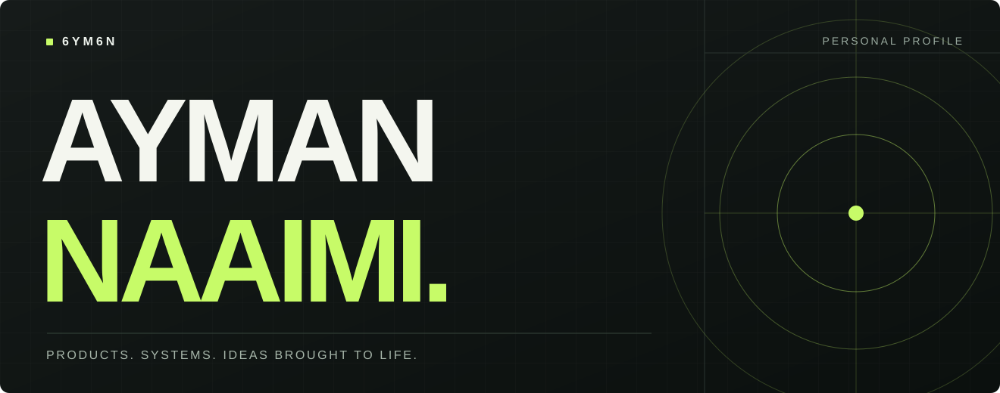

  

  <a href="https://www.dakimmo.ma/">Something live</a> &nbsp;&nbsp; / &nbsp;&nbsp;
  <a href="https://www.linkedin.com/in/aymannaaimi/">Find me on LinkedIn</a> &nbsp;&nbsp; / &nbsp;&nbsp;
  <a href="mailto:aymannaaimi@gmail.com">Start a conversation</a>

 

## The interesting part is figuring it out.

In the age of AI, the tools aren't the hard part. **Knowing what to build, finding a way through the complexity, and making it real is.**

I'm Ayman. I like the problems that don't come with instructions: the ambitious idea, the messy operation, the product with too many moving parts.

I go wherever the problem takes me — from the first sketch and user experience to the systems behind it and the last detail before launch.

**Less “what do you use?” More “can you make this happen?”**

 

## Selected work

*Some of my best work lives in private repositories. These are the stories, not the source code.*

### 01 / Dakimmo
**Building around how real-estate businesses actually work.**

A real-estate software ecosystem spanning the public product experience, business workflows, supporting services, and document-generation tools.

[See the live website](https://www.dakimmo.ma/)

### 02 / StudioCall
**What if phone calls could become intelligent workflows?**

An AI voice-agent platform for business calling and telephony integrations. Built around the challenge of turning a compelling voice demo into a coherent product. *In prototype development.*

### 03 / K&A Member Portal
**A complex client relationship, made simple to manage.**

A private client-and-team platform for property dossiers, protected documents, permissions, invitations, and day-to-day operations.

### 04 / Dakiy CRM
**The operational backbone behind the business.**

An internal platform connecting leads, opportunities, quotes, invoicing, subscriptions, and the work in between.

### Beyond those four
Websites. Internal products. Data-heavy workflows. Automation. Integrations. Unusual one-off problems that didn't fit into a ready-made product.

The point isn't the category. **It's taking ownership of the whole problem.**

 

<strong>Earlier work: where my systems thinking came from</strong>

 

Before focusing on commercial products, I worked extensively on applied AI and data problems:

- [Digital twin for predictive maintenance](https://github.com/6ym6n/digital_twin) — generating useful diagnostics from sensor data.
- [Biomedical knowledge graph](https://github.com/6ym6n/BIOMED_KG) — turning unstructured research into connected information.
- [Morocco tourism analytics](https://github.com/6ym6n/morocco-tourism-analytics) — uncovering patterns in messy, real-world data.
- [ML-AHP](https://github.com/6ym6n/ML-AHP) — building decision support for complex tradeoffs.

---

### Got a difficult one?

Tell me what you're trying to make happen.

**[Let's talk](mailto:aymannaaimi@gmail.com)** &nbsp;&nbsp; / &nbsp;&nbsp; **[LinkedIn](https://www.linkedin.com/in/aymannaaimi/)**

AYMAN NAAIMI · 6YM6N

